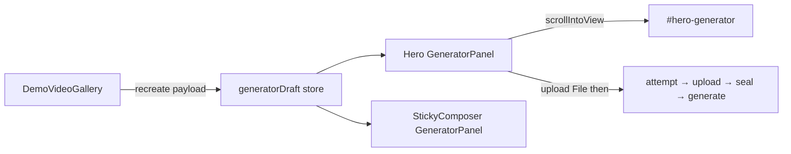

# 首页静态作品墙 + Recreate

## 概述

在首页生成区下方把现有 `DemoVideoGallery` 升级为 Higgsfield 风格的静态作品墙：hover 显示 Recreate，点击后把模版视频、参考图、提示词等参数填入 Hero 生成区。不改 genjutsu API 生命周期，Generate 仍走现有 `attempt → upload → seal → generate`。

## 已定决策

- **内容源**：静态 demo（扩展现有 [`src/components/landing/DemoVideoGallery.tsx`](../../src/components/landing/DemoVideoGallery.tsx)），不做 CMS/社区。
- **预填方式**：Recreate 时从 `public/` URL `fetch` → `File` → 填入生成区（与本地上传同构，零 API 改动）。
- **R2**：点 Recreate 不上传；用户点 Generate 时仍按现有链路上传并 seal（与手动选同一文件一致）。模版服务端复用（zombie-hug 的 `useDefaultTemplate`）留作后续优化，本阶段不做。
- **UI 范围**：hover 显示 Recreate（参考 Higgsfield）；不做 Community tabs / expand 全屏 / 侧栏工具。作者名等元数据可做轻量静态字段，非必须。

## 架构



Hero 与 Sticky 各挂一份 `GeneratorPanel`，必须用**模块级订阅 store**（非仅 props）同步 draft，否则 sticky 展开后看不到 recreate 结果。

## 数据模型

新建 `src/components/landing/demo-works.ts`（或扩写 gallery 文件）定义：

```ts
type DemoWork = {
  id: string;
  result: { src: string; poster: string; aspect: 'portrait' | 'landscape' };
  labelKey: string; // i18n
  mode: 'motion-transfer' | 'objects-swap';
  prompt: string; // 或 i18n key
  resolution?: '480p' | '720p' | '1080p';
  sourceVideo: string; // public URL, e.g. /videos/demos/.../source.mp4
  referenceImages: string[]; // public image URLs
};
```

现有 5 条 demo **只有成品视频**，没有 source/reference。实现时：

- 配置层先写好字段；
- 为至少 **1～2 条**可 recreate 的作品补齐 `public/videos/demos/<id>/` 下的 `source.mp4` + 参考图（其余条目可先只展示、Recreate disabled，或复用同一套 source 占位——以能端到端 recreate 的条目优先）。

## 关键改动

### 1. 生成区 draft store + GeneratorPanel 订阅

- 新增轻量 store，例如 `src/components/landing/generator-draft-store.ts`：`subscribe` / `getSnapshot` / `applyRecreate(draft)`。
- 在 `GeneratorPanel.tsx` 用 `useSyncExternalStore`（或等价）监听：收到 recreate 后 `setMode` / `setPrompt` / `setResolution`，并对 video/images `revoke` 旧 blob → 用 fetch 得到的 `File` 建 `MediaItem`。
- fetch 失败 toast；进行中按钮 loading（gallery 侧也可锁一点）。
- 不改变 `/api/genjutsu/*` 生命周期（符合 higgsfield-genjutsu-pipeline 规则）。

### 2. 升级 DemoVideoGallery UI

- 卡片 `relative`；默认隐藏 overlay，`:hover` / `focus-within` 显示底部右侧 **Recreate**（高对比色按钮 + 复制图标；颜色贴近现有品牌琥珀，避免强行 #CCFF00）。
- 点击 Recreate：`applyRecreate` → `document.getElementById('hero-generator')?.scrollIntoView({ behavior: 'smooth' })`。
- 保留现有网格（3 竖 + 2 横）即可，不必上真 masonry；hover 交互是重点。

### 3. Hero 接线

[`Hero.tsx`](../../src/components/landing/Hero.tsx) 已是 `GeneratorPanel` + `DemoVideoGallery`，结构保持；gallery 走 store，不需要 props 下钻。

### 4. i18n

在 `messages/en.json`、`messages/zh.json`（及现有 ja/ko）增加：`site.demo.recreate`、必要时作品标题/提示词 key。

## 明确不做

- 社区 trending/new tabs、后台 CMS、用户公开作品流。
- 改 seal/generate 以跳过模版视频上传。
- 为 Sticky 单独做第三套上传链路。

## 验证

- 桌面 hover 出 Recreate；点击后 hero 填好 mode/prompt/视频/图，可滚动到 `#hero-generator`。
- Sticky 展开后同一 draft 可见。
- 登录后 Generate 仍走 attempt → upload-url → seal → generate（手动 spot-check 一条即可）。
- `pnpm build` 通过。

## 实现待办

1. 定义 `DemoWork` 静态配置 + 可 recreate 作品的 public 素材路径
2. 新增 `generator-draft-store`，`GeneratorPanel` 订阅并 apply recreate（fetch→File）
3. `DemoVideoGallery` hover Recreate + scroll 到 hero
4. 补充 recreate / demo 相关 i18n keys
5. 手动走通 recreate 预填 + build 校验
