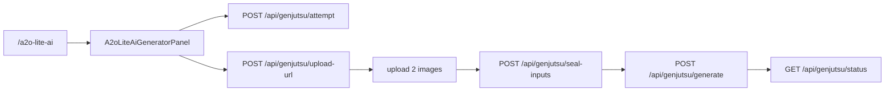

# 新增 a2o-lite-ai 固定模版页（修订版）

按 Smalltown / Crazy Frog 的固定模版产品模式，把 `/a2o-lite-ai` 挂进现有 `/api/genjutsu/*` 链路（`objects-swap` + Seedance 2.5），不新开上传/生成 API。本文档已按 Code Review 的 P1/P2 对照最新 `main` 修订；**仅方案，不含实施**。

## 0. 最新代码核对结果（相对 Review）

| 编号 | Review 结论                                            | 核对结果                 | 说明                                                                                                                                                                                                                                                                                                                                                                                                                             |
| ---- | ------------------------------------------------------ | ------------------------ | -------------------------------------------------------------------------------------------------------------------------------------------------------------------------------------------------------------------------------------------------------------------------------------------------------------------------------------------------------------------------------------------------------------------------------- |
| P1-1 | UI 硬编码 `seedance-higgsfield` 与服务端路由可能不一致 | **仍成立**               | Smalltown/Crazy Frog UI 均硬编码 `seedance-higgsfield`（见 `SmalltownBoyDanceGeneratorPanel.tsx` ~I3 注释）。服务端 `resolveProductProviderTarget` 走 `GENJUTSU_PRODUCT_PROVIDER`（空则回落 mode env）。`GENJUTSU_OBJECT_SWAP_PROVIDER` **默认是 `higgsfield`**（旧 Genjutsu，非 Seedance）。已创建任务：`upload-url` 优先复用 attempt 上的 provider/model；`generate` 有 task 时用 `task.provider`，**不会中途按 env 重路由**。 |
| P1-2 | A2O 需服务端锁死产品约束                               | **仍成立（待做）**       | `attempt.ts` 仍接受任意合法 mode；产品锁主要靠 generate 时的 `assert*Inputs`。Smalltown/Crazy Frog 已有 assert 模式可复用；A2O 尚未存在。                                                                                                                                                                                                                                                                                        |
| P1-3 | 固定 Prompt 需历史兼容                                 | **仍成立（待做）**       | Crazy Frog 已有 `LEGACY_CRAZY_FROG_PROMPTS` + allowlist；Smalltown 仍是单一 `=== DEFAULT`。A2O 应学 Crazy Frog，不要学 Smalltown。                                                                                                                                                                                                                                                                                               |
| P1-4 | i18n 不是 en/zh                                        | **仍成立（原方案写错）** | `project.inlang/settings.json`：`en` / `ja` / `ko`。消息文件仅 `messages/{en,ja,ko}.json`，无 `zh.json`。                                                                                                                                                                                                                                                                                                                        |
| P1-5 | 生产 R2 + seal 勿落入 Zombie                           | **仍成立**               | `seal-inputs.ts`：非 smalltown/crazy-frog 的 `useDefaultTemplate` **会落到 Zombie Hug 模板 key**。A2O 若不加入分支即踩坑。Workers 缺模板时 `ensureGenjutsuPublicTemplateInR2` 会明确抛错（不静默换片），但 key 选错仍会播错片。                                                                                                                                                                                                  |
| P2-1 | 双人映射 Prompt 优化                                   | **采纳并改写**           | 方向正确；须用 `@Image 1` / `@Image 2`（与 Crazy Frog / `buildSeedanceWorkflowPrompt` 一致），避免 Review 草稿里的裸 `Reference N` 与系统层「Reference 1 maps to @Image1」混淆。                                                                                                                                                                                                                                                 |
| P2-2 | Panel 复制 vs 小抽取                                   | **首版选 A**             | Smalltown panel ~1107 行、Crazy Frog ~1357 行；无现成共享 FixedTemplate Panel。首版复制精简版风险更低；不引入大框架、不改现有两页行为。                                                                                                                                                                                                                                                                                          |
| P2-3 | ~20s 成本 / 默认分辨率                                 | **采纳**                 | 实测时长 ~19.948s。默认分辨率首版用 **480p**（Smalltown 默认 720p）；Credit Gate / 支付后续跑复用现有逻辑。不改全局定价。                                                                                                                                                                                                                                                                                                        |

已解决、无需为本页再改的部分：

- Seedance 家族服务端 reserve 已用 `customerPriceBasisUsd ?? providerCostUsd`（`generate.ts`）。
- 任务生命周期内 provider/model 粘性（attempt → upload-url → generate）机制已存在。
- `buildSeedanceWorkflowPrompt(objects-swap)` 已覆盖完整替换 / 保运镜；产品层只写映射即可。

---

## 1. 总体技术方向（保留）

- 路由：`/a2o-lite-ai`；用户上传 **2 张**参考图。
- `mode = objects-swap`；Seedance 2.5 家族 provider（见 §2.1）。
- 复用：`attempt → upload-url → upload → seal-inputs → generate → status`。
- 复用：Billing、R2、任务恢复；**不**新增 `/api/a2o-lite-ai/*`。
- 固定：服务端模板、Prompt、`4:3`、仅 `480p`/`720p`。
- 首版：无 Preview；不重构首页 / Crazy Frog / Smalltown。
- 原则：最小必要改动、最大化复用、服务端约束可靠、计费准确。



### 模版事实

- 源：`/Users/coderlim/Downloads/genjutsu-ai/a2o-lite-ai-twins-tpl-25s.mp4`
- 时长：**19.948005s**（文件名 25s 不准）
- 分辨率：**960×720 → aspect `4:3`**
- 内容：白棚双人制服舞；原片可用 auburn / 深发色区分两人；含单人特写与双人全景

---

## 2. P1 解决方式（首版必须）

### 2.1 P1-1 Provider 与积分预估一致

**问题：** 若 A2O 只跟 `resolveProductProviderTarget` 且 env 未配，会落到默认 `higgsfield`（旧 Genjutsu）。UI 若照抄 Smalltown 硬编码 `seedance-higgsfield`，在生产切到 WaveSpeed/SeeAPI 时预估会漂。

**A2O 专用策略（不改其他产品费率/配置语义）：**

1. **服务端 pin（仅 `product === 'a2o-lite-ai'`）**  
   新增小函数（建议放 `src/modules/a2o-lite-ai/provider.ts` 或 `workflow.ts` 旁的 product helper）：
   - 先 `resolveProductProviderTarget('a2o-lite-ai', 'objects-swap')`
   - 若结果 **不是** Seedance 家族（`seedance` / `seedance-volcengine` / `seedance-higgsfield` / `seedance-seeapi` / `seedance-wavespeed`），则 **强制** 使用 A2O 默认：`seedance-higgsfield`（常量 `A2O_LITE_DEFAULT_PROVIDER`）
   - 若已是 Seedance 家族，沿用 env 解析结果（允许运维用 `GENJUTSU_PRODUCT_PROVIDER` 切 WaveSpeed/SeeAPI 等）
   - **禁止** A2O 任务落到旧 `higgsfield` Genjutsu
2. **attempt / upload-url** 创建或绑定 A2O 时一律走上述 pin；已存在 task 时继续优先复用 task 上的 `provider`/`model`（与现网 C1 一致）。
3. **UI 预估与服务端同一来源**
   - 路由 `loader`（服务端）调用同一 pin 函数，把 `{ provider, model }` 或至少 `provider` 传给 Panel
   - Panel：`estimateGenjutsuCreditsForProvider({ provider: loaderProvider, durationSeconds: 19.948005, resolution, aspectRatio: '4:3' })`
   - **禁止** 前端写死一个可能与 pin 结果不同的 provider
   - 不新增公开 env；不改 Crazy Frog/Smalltown 现有硬编码行为
4. **不** 借此做全站 Provider 重构；不改其他产品的 env 默认值与费率表。

### 2.2 P1-2 服务端锁定 objects-swap 与产品约束

对齐 Smalltown assert，并在更早关口拒绝脏请求：

| 约束                 | 值                                                          |
| -------------------- | ----------------------------------------------------------- |
| `product`            | `a2o-lite-ai`                                               |
| `mode`               | `objects-swap`（attempt / upload-url 对 A2O 拒绝其他 mode） |
| `aspectRatio`        | `4:3`                                                       |
| `resolution`         | `480p` \| `720p`                                            |
| 参考图               | 恰好 2 张 image/\*                                          |
| `useDefaultTemplate` | `true`                                                      |
| `prompt`             | 见 §2.3 allowlist                                           |

实现：

- `assertA2oLiteAiInputs(options)`（generate 必调）
- `attempt` / `upload-url`：`product === a2o-lite-ai` 时校验 mode + resolution；upload-url 纳入 `isFixedTemplateProduct`，绑 `useDefaultTemplate` + `aspectRatio: '4:3'`
- 生命周期：provider/model 以 attempt 落库为准；generate 有 task 时不按 env 重算（现网已满足，A2O 测试覆盖即可）

### 2.3 P1-3 固定 Prompt 版本兼容

学 Crazy Frog，不学 Smalltown：

- 新任务客户端/服务端只写入 **最新** `A2O_LITE_DEFAULT_PROMPT`
- `assert`：`ALLOWED = new Set([...LEGACY_A2O_LITE_PROMPTS, A2O_LITE_DEFAULT_PROMPT])`，严格相等
- 已创建未完成任务继续用 options 里保存的旧版 Prompt
- 禁止任意自定义 Prompt
- 单测：最新通过、legacy 通过、任意篡改拒绝

### 2.4 P1-4 i18n

- 只改 `messages/en.json`、`messages/ja.json`、`messages/ko.json` 的 `site.a2o.*`
- **不** 新增 `zh` 或未启用 locale
- canonical / hreflang / sitemap 与 en/ja/ko 一致；日韩必须是真实翻译，禁止英文化冒充
- 隐藏 Prompt **不** 进 i18n

### 2.5 P1-5 生产 R2 模板部署

资产：

- `public/videos/a2o-lite-ai-tpl.mp4` + `a2o-lite-ai-tpl-poster.jpg`
- 版本化 key：`genjutsu/templates/a2o-lite-ai-v1.mp4`（env `A2O_LITE_AI_TEMPLATE_VIDEO_KEY` 可覆盖）

`seal-inputs` **必须**在 Zombie 回落之前增加：

```text
product === a2o-lite-ai → getA2oLiteAiTemplateVideoKey()
```

`sealGenjutsuTemplateR2Inputs` 允许该 shared key（与 smalltown/crazy-frog 并列）。

上线前检查清单：

1. 将模板上传到上述版本化 R2 key
2. 校验 Content-Type（`video/mp4`）、大小、时长≈19.95s、可读（signed GET / head）
3. 公开预览（`public/videos/...`）与服务端 seal 使用**同一内容版本**（更新模版时同步升 key 版本号）
4. Workers 缺对象时明确失败（现有 ensure 行为），**不得**落到 Zombie/Crazy Frog/Smalltown key
5. 回归：重新部署后新任务 seal 的 videoKey 前缀/模板身份正确；恢复中的旧任务仍读自己 sealed 对象

---

## 3. P2 解决方式

### 3.1 P2-1 双人身份映射 Prompt（候选，落常量前可微调）

发色/开场站位仅用于识别**原片**角色；不限制替换后发色。跨镜头身份固定；禁止一图两人。通用完整替换规则仍由 `buildSeedanceWorkflowPrompt` 处理。

引用格式与 Crazy Frog 一致：`@Image 1` / `@Image 2`（不要用裸 `Reference 1`，以免与系统层 Reference 映射句重复/冲突）。

```text
In the original @Video1, identify two distinct dancers:

Dancer A: the dancer with warmer auburn or reddish-brown hair in the original video, generally nearer the camera in the opening shots.
Replace Dancer A with @Image 1.

Dancer B: the dancer with darker black or dark-brown hair in the original video, generally farther from the camera in the opening shots.
Replace Dancer B with @Image 2.

These labels refer to the two original dancers before replacement. Keep each original dancer's role consistently assigned across solo close-ups, two-person shots, position changes, and full-body dance shots.

Do not exchange the two assignments or apply one reference to both dancers.
```

UI 槽位：Photo 1 / Photo 2（简短说明对应原片 auburn / dark-hair **角色**，不暴露全文）。

### 3.2 P2-2 GeneratorPanel

**首版选 A：复制精简版 `A2oLiteAiGeneratorPanel`（以 Smalltown 为底，去掉无关 SEO/文案耦合）。**

不选 B（共享状态机抽取）：收益有限，却可能误伤 Crazy Frog/Smalltown；与「最小改动 / 易 Review」冲突。后续若第三、第四个双图固定页再出现，再评估小范围抽取 PhotoSlot + genjutsu 客户端状态机。

约束：不为 A2O 引入 FixedTemplate 大框架；不重构首页 `GeneratorPanel`；不改 Crazy Frog/Smalltown 行为。

### 3.3 P2-3 价格与体验

- 默认分辨率：**480p**（降低 ~20s 片首次门槛）；仍可选 720p
- 生成前展示 loader 注入 provider 的预计积分
- 余额不足：现有 Credit Gate；支付后续跑 / 刷新恢复与 Smalltown 同模式
- 首版不做 Preview
- **不** 改积分包或全局定价

---

## 4. 实现步骤与文件清单

### 4.1 首版必须（Must）

| 文件                                                 | 改动范围                                                                           |
| ---------------------------------------------------- | ---------------------------------------------------------------------------------- |
| `public/videos/a2o-lite-ai-tpl.mp4`                  | 模版资产                                                                           |
| `public/videos/a2o-lite-ai-tpl-poster.jpg`           | 海报                                                                               |
| `src/modules/a2o-lite-ai/constants.ts`               | product/mode/aspect/resolutions/duration/default+legacy prompts/默认 provider 常量 |
| `src/modules/a2o-lite-ai/assert.ts` (+ test)         | 产品锁 + prompt allowlist                                                          |
| `src/modules/a2o-lite-ai/provider.ts`（或等价）      | Seedance 家族 pin；供 attempt 与 route loader 共用                                 |
| `src/modules/genjutsu/types.ts`                      | `GenjutsuProductId` 增加 `a2o-lite-ai`                                             |
| `src/modules/genjutsu/workflow.ts`                   | `isGenjutsuProductId` / 常量导出                                                   |
| `src/modules/genjutsu/storage.ts`                    | get/ensure A2O template；seal 允许列表                                             |
| `src/modules/genjutsu/product-provider.test.ts`      | allowlist + A2O pin 行为                                                           |
| `src/config/index.ts` + `.env.example`               | `a2o_lite_ai_template_video_key`                                                   |
| `src/routes/api/genjutsu/attempt.ts`                 | A2O mode/resolution + pin provider                                                 |
| `src/routes/api/genjutsu/upload-url.ts`              | fixed-template 2 图、aspect、pin、模板 ensure                                      |
| `src/routes/api/genjutsu/seal-inputs.ts`             | **A2O key 分支，避免 Zombie 回落**                                                 |
| `src/routes/api/genjutsu/generate.ts`                | `assertA2oLiteAiInputs` + aspect                                                   |
| `src/components/landing/A2oLiteAiGeneratorPanel.tsx` | 精简复制 Smalltown；积分用 loader provider                                         |
| `src/routes/a2o-lite-ai.tsx`                         | 页 + loader 注入 creditEstimateProvider                                            |
| `messages/en.json` / `ja.json` / `ko.json`           | `site.a2o.*`                                                                       |
| `src/components/landing/SiteHeader.tsx`              | 导航入口（若需要）                                                                 |
| `src/components/landing/motion-templates.ts`         | `href: '/a2o-lite-ai'`                                                             |
| `src/routes/sitemap[.]xml.ts` / `llms[.]txt.ts`      | 路径                                                                               |

### 4.2 可后续迭代（Later）

- 共享双图固定模板 Panel / 状态机抽取（P2-2 方案 B）
- 完整 SEO HowTo 图集（对标 Smalltown 五步）
- Crazy Frog 式 Preview 短片
- 修正 Smalltown/Crazy Frog 自身的 UI 硬编码预估债务（**非本页范围**）

---

## 5. 对线上功能的影响与回归风险

| 面                     | 风险           | 缓解                                                                                          |
| ---------------------- | -------------- | --------------------------------------------------------------------------------------------- |
| 首页 Genjutsu          | 低             | 不改 homepage panel / 默认 env 语义                                                           |
| Crazy Frog / Smalltown | 低～中         | 仅扩展 allowlist 与 seal 分支；assert/计价逻辑保持分支隔离；上线后 spot-check 两页各 1 次生成 |
| seal-inputs            | 中（若漏分支） | 代码审查重点：A2O 绝不能进 Zombie key；单测覆盖 product→key 映射                              |
| Provider env           | 低             | A2O pin 仅在 `product === a2o-lite-ai`；不改全局默认 `higgsfield`                             |

---

## 6. 测试与验收

自动化 / 手工：

1. 两图 → seal → generate → status → 完成下载
2. 服务端拒绝：错 prompt / mode / aspect / resolution / 图数量
3. attempt→generate 的 provider/model 一致；切换 env 后**新**任务跟 pin，**旧**任务不改绑
4. UI 预估积分与服务端 reserve 一致（覆盖实际 pin 到的 provider；至少测默认 `seedance-higgsfield`）
5. 模板 key 不与 Zombie / Crazy Frog / Smalltown 混淆
6. Prompt 升级后：legacy options 仍可 assert；新任务只用最新
7. 上传失败 / 余额不足 / provider 失败：现有错误与退款路径
8. 刷新恢复进行中任务
9. 首页 + Crazy Frog + Smalltown 无回归
10. `pnpm build` + 相关单测通过

上线前人工：

- 两张不同人物图真实跑完整 ~20s，检查单人特写 / 切镜 / 双人舞身份不交换
- 核对实际 Provider 账单与用户积分
- **授权**：确认模版视频、BGM、肖像素材可商用后再上线

---

## 7. 交付边界

- 本文档路径：`docs/plans/a2o-lite-ai.md`
- **等待明确开发指令后再写业务代码**
- 核心原则：最小必要改动、最大化复用、服务端约束可靠、计费准确、可维护、易 Review，不破坏线上现有功能；不为本次 Review 做全站架构重构
