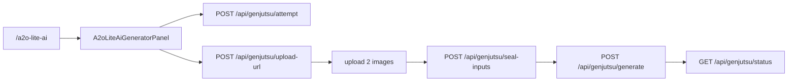

# 新增 a2o-lite-ai 固定模版页

按 Smalltown / Crazy Frog 的固定模版产品模式，把 a2o-lite-ai 挂进现有 `/api/genjutsu/*` 链路（objects-swap + Seedance 2.5），不新开上传/生成 API；隐藏提示词按 twins 模版双人身份映射编写。

## 复用结论（不要另起炉灶）

已有可直接对齐的产品形态是 **Crazy Frog / Smalltown**，不是 hotel-lobby、zombie-hug、kairo：

| 层            | 复用什么                                                                                                                      | 不要做什么                                         |
| ------------- | ----------------------------------------------------------------------------------------------------------------------------- | -------------------------------------------------- |
| API           | `attempt` → `upload-url` → upload → `seal-inputs` → `generate` → `status`                                                     | 不要 `/api/a2o-lite-ai/*`                          |
| Provider      | `GenjutsuProductId` + `resolveProductProviderTarget`（走 `GENJUTSU_OBJECT_SWAP_PROVIDER` / 可选 `GENJUTSU_PRODUCT_PROVIDER`） | 不要新 provider 适配器                             |
| Prompt 系统层 | `buildSeedanceWorkflowPrompt`（objects-swap）已含完整替换/保运镜规则                                                          | 产品页只锁 **user instruction**（隐藏固定 prompt） |
| UI            | 以 [`SmalltownBoyDanceGeneratorPanel`](../../src/components/landing/SmalltownBoyDanceGeneratorPanel.tsx) 为模板复制精简版     | 不要再拷一份 homepage `GeneratorPanel`             |



「使用 sd25」= 与现有产品页相同的 Seedance 2.5 家族路由（生产通常靠 `GENJUTSU_OBJECT_SWAP_PROVIDER` / `GENJUTSU_PRODUCT_PROVIDER` 指向 `seedance-*`）。本页 **不** 再发明第三套 provider 开关。

## 模版事实（已用 ffprobe 确认）

- 源文件：`/Users/coderlim/Downloads/genjutsu-ai/a2o-lite-ai-twins-tpl-25s.mp4`
- 时长：约 **19.948s**（文件名 25s 不准确，常量用实测）
- 分辨率：**960×720 → 固定 aspect `4:3`**
- 内容：白棚双人 JK 风制服同步舞； auburn / 深发色两人贯穿全片；有单人特写与双人全景

## 实现步骤

### 1. 资产

- 复制到 `public/videos/a2o-lite-ai-tpl.mp4`
- 抽一帧做 `public/videos/a2o-lite-ai-tpl-poster.jpg`
- R2 key（env 可覆盖）：`genjutsu/templates/a2o-lite-ai-v1.mp4`（与 Crazy Frog / Smalltown 同前缀）

### 2. 新产品模块（对齐 smalltown / crazy-frog）

新增 [`src/modules/a2o-lite-ai/constants.ts`](../../src/modules/a2o-lite-ai/constants.ts) + [`assert.ts`](../../src/modules/a2o-lite-ai/assert.ts)：

- `product = 'a2o-lite-ai'`
- `mode = 'objects-swap'`
- `aspectRatio = '4:3'`
- `resolutions = ['480p','720p']`（与现有产品页一致，先不上 1080p）
- `TEMPLATE_DURATION_SECONDS = 19.948005`
- `A2O_LITE_DEFAULT_PROMPT`（服务端校验严格相等；**不对用户暴露**）

**隐藏 user instruction（草稿，实现时落常量）：** 只写目标映射；完整替换/跨镜头一致性交给 `buildSeedanceWorkflowPrompt`：

```text
Replace the dancer with the warmer reddish-brown / auburn hair — often nearer the camera in the opening close-ups — with @Image 1.
Replace the dancer with darker black or dark-brown hair — often farther or partially behind in the opening — with @Image 2.
Keep these two identities distinct in every shot size: solo close-ups, dual medium shots, and full-body wide dance shots.
When only one dancer is clearly visible, assign the matching Image by role continuity (hair color / who was nearer vs farther in the opening), never clone one Image onto both dancers.
```

UI 槽位文案：`Photo 1` / `Photo 2`（对应 @Image1 / @Image2），简短说明 auburn 角色 / dark-hair 角色，不暴露完整 prompt。

### 3. 挂进现有 Genjutsu 产品 allowlist（点状扩展，不重构）

改这些现有分支，把 `a2o-lite-ai` 与 smalltown/crazy-frog 并列：

- [`src/modules/genjutsu/types.ts`](../../src/modules/genjutsu/types.ts) — `GenjutsuProductId`
- [`src/modules/genjutsu/workflow.ts`](../../src/modules/genjutsu/workflow.ts) — `A2O_LITE_AI_PRODUCT` + `isGenjutsuProductId`
- [`src/modules/genjutsu/storage.ts`](../../src/modules/genjutsu/storage.ts) — `getA2oLiteAiTemplateVideoKey` / `ensureA2oLiteAiTemplateInR2`；`sealGenjutsuTemplateR2Inputs` 允许该 shared key
- [`src/config/index.ts`](../../src/config/index.ts) + `.env.example` — `a2o_lite_ai_template_video_key`
- API：[`attempt.ts`](../../src/routes/api/genjutsu/attempt.ts)、[`upload-url.ts`](../../src/routes/api/genjutsu/upload-url.ts)、[`seal-inputs.ts`](../../src/routes/api/genjutsu/seal-inputs.ts)、[`generate.ts`](../../src/routes/api/genjutsu/generate.ts) — 分辨率/模板/assert/aspect 分支
- 测试：扩展 [`product-provider.test.ts`](../../src/modules/genjutsu/product-provider.test.ts) + 新 `assert.test.ts`

`upload-url` 里 `isFixedTemplateProduct` 对 a2o 同样：只收 **2 张图**，`useDefaultTemplate: true`，aspect `4:3`。

### 4. 页面与 Panel

- 路由 [`src/routes/a2o-lite-ai.tsx`](../../src/routes/a2o-lite-ai.tsx)：结构跟 [`smalltown-boy-dance.tsx`](../../src/routes/smalltown-boy-dance.tsx)（header + hero + generator；首版 SEO sections 可精简：title/description/FAQ 基础即可，不做 5 步 HowTo 图集除非你要同级 SEO）
- Panel：从 Smalltown panel 复制为 `A2oLiteAiGeneratorPanel`，只换 constants / 槽位文案 / storage key / sign-in callback `/a2o-lite-ai#generator`
- 积分预估：与 Smalltown 一样用 `estimateGenjutsuCreditsForProvider({ provider: 'seedance-higgsfield', ... })` 做 UI 报价一致性（真实扣费仍以服务端 attempt 绑定的 provider 为准）

### 5. 发现入口与 i18n

- `messages/en.json` + `zh.json`（及现有 locale 文件若需同步）：`site.a2o.*` 页文案；**不**把隐藏 prompt 放进 i18n
- [`SiteHeader`](../../src/components/landing/SiteHeader.tsx)、[`motion-templates.ts`](../../src/components/landing/motion-templates.ts)（`href: '/a2o-lite-ai'`）、sitemap / `llms.txt` 加路径
- 文案遵守 AGENTS：对外不写 Seedance/Higgsfield 等上游名；可用「Genjutsu · twins dance · 2 photos」类描述

## 首版刻意不做

- 不抽「通用 FixedTemplateProduct 框架」大重构（要求后续改动面小 → 宁可再复制一份 product 模块，与现网 Crazy Frog/Smalltown 一致）
- 不做 Crazy Frog 的 preview 短片路径
- 不迁 hotel-lobby / zombie-hug

## 验收

- 本地：模版从 `public/videos` seed 进 R2；上传两图可走完整链路到 `ready`/`reserved`
- `assertA2oLiteAiInputs` 拒绝改 prompt / 错 aspect / 非 2 图
- `pnpm build` 通过
