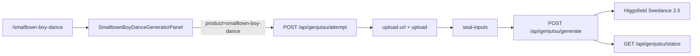

# Smalltown Boy Dance（Higgsfield Seedance 2.5）

Status: **proposal — pending review**（实现未开始）

Route: `/smalltown-boy-dance`  
Product: `smalltown-boy-dance`  
Provider (this page only): `seedance-higgsfield` → `bytedance/seedance-2.5/reference-to-video`

## 决策（已确认）

- **双人**：前一人 + 后一人，各 1 张参考图
- **Provider**：新增并本页强制 `seedance-higgsfield` → `POST /bytedance/seedance-2.5/reference-to-video`（现有 `HF_API_KEY` + `/requests/{id}/status` 轮询）；**不用** Fal Seedance（真人限制）
- **管线**：首页 Genjutsu 链 `attempt → upload-url → upload → seal-inputs → generate → status`（对齐 `.cursor/rules/higgsfield-genjutsu-pipeline.mdc`）
- **参考 UI**：生成器交互参考 Crazy Frog 双图槽；面板实现参考 `Bulin47GeneratorPanel`（固定模版 + genjutsu API）
- **SEO**：暂不做 FAQ/HowTo/长文案/sitemap 优化；稍后补文案

## 架构

本页 `attempt` 带 allowlisted `product: 'smalltown-boy-dance'`，服务端映射到 `{ provider: 'seedance-higgsfield', model: 'bytedance/seedance-2.5/reference-to-video' }`，**不信任客户端直接传任意 provider**。

## 模版资产

| Item                 | Value                                                               |
| -------------------- | ------------------------------------------------------------------- |
| Source (local)       | `/Users/coderlim/Downloads/genjutsu-ai/smalltown-boy-dance-tpl.mp4` |
| Public path          | `/videos/smalltown-boy-dance-tpl.mp4` (+ poster jpg)                |
| Duration             | ~21.46s（Higgsfield duration 整数 clamp 到 4–30 → **21**）          |
| Resolution of source | 562×748 → aspect metadata **`3:4`**                                 |
| Default output       | `720p`                                                              |

## 后端：Higgsfield Seedance provider

1. 扩展 `src/modules/genjutsu/types.ts`：`GenjutsuProvider` 增加 `'seedance-higgsfield'`
2. 新增 `src/modules/genjutsu/seedance-higgsfield.ts`：
   - Payload（对齐 Higgsfield schema，**无** Fal 的 `task` / `codec` / `end_user_id` / `duration:"auto"`）：
     - `prompt`（用现有 `buildSeedanceWorkflowPrompt` + 固定双人替换 instruction）
     - `image_urls`（2 张）、`video_urls`（模版）
     - `duration`: `Math.round(clamp(sourceSeconds, 4, 30))`
     - `aspect_ratio`: `'3:4'`
     - `resolution`、`generate_audio`、`bitrate_mode`
   - `submit` 走现有 Higgsfield `providerFetch`（`Authorization: Key …`）
   - `status` 复用 `getHiggsfieldStatus` 同路径 `/requests/{id}/status`
   - 计费复用 `estimateSeedanceProviderCost`（与现有 Seedance list rate 一致）
3. 接线 `service.ts` / `workflow.ts` / `pricing.ts`：cost / submit / status / browser estimate 识别新 provider
4. `attempt.ts`：允许 `product === 'smalltown-boy-dance'` 时覆盖 `resolveGenjutsuProviderTarget`；其它 product 忽略
5. `generate.ts`：把 `seedance-higgsfield` 与现有 seedance 一样纳入「需要 sourceDurationSeconds」分支

## 产品常量 + 固定 Prompt

新增 `src/modules/smalltown-boy-dance/constants.ts`（照抄 bulin/rumpel 模式）：

- `PRODUCT_ID = 'smalltown-boy-dance'`
- `MODE = 'objects-swap'`
- 公开模版路径、时长常量、默认 `720p`、`aspect 3:4`
- 固定 user prompt（双角色，风格对齐 Crazy Frog 短祈使句）：
  - `@Video1` 只提供动作/机位/编舞
  - `@Image1` → 前面的人；`@Image2` → 后面的人
  - 明确 “do not keep the original …” / “Do not swap Image1 and Image2”
- `loadSmalltownBoyDanceTemplateFile()` 从 `/videos/smalltown-boy-dance-tpl.mp4` fetch

## 前端

1. 复制模版到 `public/videos/smalltown-boy-dance-tpl.mp4`，ffmpeg 抽帧做 poster
2. 新增 `src/components/landing/SmalltownBoyDanceGeneratorPanel.tsx`：
   - 基于 Bulin 面板的 genjutsu 链
   - 双图槽（Front / Back），模版不可替换、不可 trim
   - `attempt` body 带 `product: 'smalltown-boy-dance'`
   - media 顺序：`[template, front, back]`
3. 新增精简页 `src/routes/smalltown-boy-dance.tsx`：Header + 短标题 + Generator（无 FAQ/HowTo/案例 SEO 段）
4. 最小 i18n：`site.smalltown.*` 仅覆盖面板/短标题必要文案
5. `SiteHeader` 加一条入口（与 Crazy Frog / Bulin 同级）

## 测试与验证

- 单测：Higgsfield Seedance payload（duration 整数、无 `task`、aspect `3:4`、双图）；`product` → provider 映射；非法 product 不改默认 provider
- 本地：复制模版后开 `/smalltown-boy-dance`，确认 attempt 落库 `provider=seedance-higgsfield`
- 真实生成会产生费用，需人工确认后再跑

## 明确不做（本次）

- 不改全局 `GENJUTSU_*_PROVIDER` 默认值（首页仍走现有 Volcengine/Fal 配置）
- 不复用 `/api/hotel-lobby/*` / Kling
- 不做完整 SEO（sitemap/FAQ/案例视频/长文案等稍后补）

## 实现待办（review 通过后再做）

1. 新增 `seedance-higgsfield` provider（submit/status/cost）并接入 service/workflow/pricing/generate
2. `attempt` 支持 allowlisted `product=smalltown-boy-dance` 强制 provider
3. constants + 复制模版/poster 到 `public/videos`
4. `SmalltownBoyDanceGeneratorPanel` + `/smalltown-boy-dance` 精简页 + 最小 i18n + Header 入口
5. payload / product 映射单测
