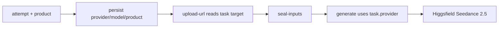

# Smalltown Boy Dance（Higgsfield Seedance 2.5）

Status: **proposal — revised after review**（实现未开始）

Route: `/smalltown-boy-dance`  
Product: `smalltown-boy-dance`  
Provider (this page only): `seedance-higgsfield` → `bytedance/seedance-2.5/reference-to-video`

## 决策（已确认）

- **双人**：前一人 + 后一人，各 1 张参考图
- **Provider**：新增并本页强制 `seedance-higgsfield` → `POST /bytedance/seedance-2.5/reference-to-video`（现有 `HF_API_KEY`）；**不用** Fal Seedance（真人限制）
- **管线**：首页 Genjutsu 链 `attempt → upload-url → upload → seal-inputs → generate → status`
- **参考 UI**：双图槽参考 Crazy Frog；面板实现参考 `Bulin47GeneratorPanel`
- **SEO**：首版做基础 SEO（见下）；FAQ/长文案/案例视频后补
- **成本**：21s 全长生成较贵；**先用 4–6s 短片段**做模型/真人/扣费实测，正式页是否提供短版选项看舞蹈效果再定，不为降成本盲目截断关键编舞

## Review 结论采纳

静态 Review（ChatGPT）已核对代码后采纳。**C1–C3 必须在正式开发前写入方案并优先实现**；I1–I7 作为首版硬要求；基础 SEO 首版带上。

### Critical（必须）

#### C1. Provider 全链路一致（已核实会 409）

现状：[`upload-url.ts`](../../src/routes/api/genjutsu/upload-url.ts) L94–109 也会 `resolveGenjutsuProviderTarget(mode)` 再 `createGenjutsuAttempt` / `bindGenjutsuUploadInputs`。`createGenjutsuAttempt` 会比对已有任务的 `provider`/`model`，不一致抛 `GENERATION_INPUT_CONFLICT`。

若只在 `attempt` 覆盖成 `seedance-higgsfield`，而 `upload-url` 仍用全局 `objects-swap` 配置 → **上传前 409，流程断死**。

**修复（写死进方案）：**

1. 新增服务端 `resolveProductProviderTarget(product, mode)`：allowlist 映射  
   `smalltown-boy-dance` → `{ provider: 'seedance-higgsfield', model: 'bytedance/seedance-2.5/reference-to-video' }`；未知 product → 回退 `resolveGenjutsuProviderTarget(mode)`。
2. `attempt` 创建任务时把可信 `product` 写入 `aiTask.options`（与 mode/resolution/prompt 一起）。
3. `upload-url` / `seal-inputs` / `generate`：**优先使用已持久化任务的 `provider` + `model`**（及 options.product），禁止在后续阶段重新按全局 env 覆盖 product 页的 target。若任务尚不存在（防御路径），则要求同一 `product` 再解析一次，且必须与后续绑定一致。
4. **端到端测试**：`smalltown-boy-dance` 从 attempt → upload-url → seal → generate 全链路保持 `seedance-higgsfield`；首页 / Bulin 仍走原有 Provider，不回归。

#### C2. 独立 Higgsfield Seedance 计价（禁止复用 Fal 费率）

**不要**调用现有 `estimateSeedanceProviderCost`（Fal list rate，如 720p `$0.34056`/billed-second）。按官网 Token 公式粗算（21.46s 模版 + 21s 输出、假设 720×960）约 **$8.83 / ~1502 credits** vs Fal 公式 **$14.62 / ~2485 credits**——会明显伤害套餐体验（Pro $19.99 / 1750）。

**修复：**

1. 新增 `estimateHiggsfieldSeedanceProviderCost`（或同模块函数），至少纳入：`duration`、`sourceDurationSeconds`、`resolution`、`aspectRatio`（推算输出像素），按 Higgsfield Seedance 2.5 reference-to-video **Token 计费**（输入视频时长 + 生成时长均计费）。
2. 客户端预估与服务端 reserve **同一套公式**。
3. 冒烟后用 **一次真实任务对照 Higgsfield 账单**校准；折扣/实际输出尺寸以账单为准，公式可调系数但不得回退到 Fal 固定费率。

#### C3. 异常类型接入退款保护 + 抽取共享 HTTP

[`generate.ts`](../../src/routes/api/genjutsu/generate.ts) L393–499：明确 Preflight/4xx → 退款；5xx/超时等不确定 → 保持冻结（`SUBMISSION_UNKNOWN`）。

**修复：**

1. 新 provider **直接复用**（或 re-export）现有 `HiggsfieldHttpError` / `HiggsfieldPreflightError`，**不要**另起一套未被 `instanceof` 识别的 Error。
2. 将 `providerFetch`、`getHiggsfieldStatus`（及鉴权/base URL）从 `service.ts` **抽到共享模块**（如 `src/modules/genjutsu/higgsfield-client.ts`），供 genjutsu motion 与 `seedance-higgsfield` 共用——方案中的「复用」必须是可 import 的公开 API，不是私有函数口头复用。
3. 单测覆盖：4xx / 429 / 5xx / timeout / 丢失 `request_id` → 分别走退款 vs 冻结。

### Important（首版硬要求）

| ID  | 要求                                                                                                                                                               |
| --- | ------------------------------------------------------------------------------------------------------------------------------------------------------------------ |
| I1  | **服务端固定模板**：校验 `product`、恰好 2 张图、顺序 `[video, front, back]`、以及模板身份（与公开模版 hash/size 或受控 R2 template key 一致）。仅前端锁模版不够。 |
| I2  | Prompt 用 reference-to-video 语义实测；`objects-swap` 包装词可能偏「编辑」，需真实生成验证双人编舞是否保留。                                                       |
| I3  | 客户端积分预估 **固定** `seedance-higgsfield` 公式，不读全局 `genjutsu_object_swap_provider`。                                                                     |
| I4  | `generate.ts` 里 Seedance 的服务端 R2 时长/输入校验分支覆盖 `seedance-higgsfield`，不只加 duration 枚举。                                                          |
| I5  | 确认完成态含现有 `getHiggsfieldStatus` 可读的 `video.url`（或等价字段），成功后能落 R2。                                                                           |
| I6  | `generate_audio` 默认行为写死并文档化（建议默认 `true` 与站内 Seedance 一致）；**不假设**保留模版原曲；素材/音乐授权产品侧确认。                                   |
| I7  | 上线前做 **真人双图** 实测；若安全策略拒识，走现有失败退款路径。                                                                                                   |

### SEO（首版最小，不做长文）

暂不做 FAQ / HowTo / 案例长文，但首版必须有：

- 独立 Title / Description / H1
- canonical + 与实际翻译覆盖一致的 hreflang
- OG 图（可用模版 poster）
- 加入 [`sitemap.xml.ts`](../../src/routes/sitemap[.]xml.ts) 的 `STATIC_PATHS`

### API 参数核对

| 参数           | 方案值                                      | 结论                                                                                   |
| -------------- | ------------------------------------------- | -------------------------------------------------------------------------------------- |
| Model ID       | `bytedance/seedance-2.5/reference-to-video` | 正确                                                                                   |
| image_urls     | 2                                           | 支持                                                                                   |
| video_urls     | 1                                           | 支持                                                                                   |
| duration       | 整数 21（全长）                             | 合法 4–30；短片段冒烟用 4–6                                                            |
| aspect_ratio   | `3:4`                                       | 支持                                                                                   |
| resolution     | `720p`                                      | 支持                                                                                   |
| generate_audio | boolean                                     | 支持；默认写死                                                                         |
| bitrate_mode   | 方案曾写 `standard`                         | **实现前对照 OpenAPI 再定**：官方 playground 示例用过 `high`；以当前 schema 为准再提交 |

21.46s → 21s 合法，但不保证末尾半秒动作同步；冒烟时留意片尾。

## 模版资产

| Item                 | Value                                                               |
| -------------------- | ------------------------------------------------------------------- |
| Source (local)       | `/Users/coderlim/Downloads/genjutsu-ai/smalltown-boy-dance-tpl.mp4` |
| Public path          | `/videos/smalltown-boy-dance-tpl.mp4` (+ poster jpg)                |
| Duration             | ~21.46s（全长页；冒烟用短片段）                                     |
| Resolution of source | 562×748 → aspect **`3:4`**                                          |
| Default output       | `720p`                                                              |

## 实施顺序（强制）

1. **先验证模型**（人工付费、短 4–6s）：双人替换、真人、Prompt、画幅、返回结构、实际扣费 vs 公式。
2. **独立 Provider**：抽取共享 Higgsfield HTTP/status/error；`seedance-higgsfield` payload + **独立 Token 定价**。
3. **任务目标一致性（C1）**：product 持久化；attempt / upload-url / seal / generate 同一份 provider/model；E2E 测试。
4. **固定模板页面**：双图 Front/Back、服务端模板校验、独立积分预估、基础 SEO。
5. **完整回归**：落 R2、失败退款、刷新恢复、余额不足；首页与 Bulin47 等不回归。

## 后端要点（修订后）

1. `GenjutsuProvider` 增加 `'seedance-higgsfield'`
2. 抽取 `higgsfield-client.ts`；新增 `seedance-higgsfield.ts`（payload / submit / 独立 estimate）
3. `resolveProductProviderTarget` + options.product；全链路读 task 上的 target
4. `generate.ts`：新 provider 走 Seedance 时长校验 + Higgsfield 错误类型退款分支
5. 服务端产品约束（I1）：2 图、固定 prompt、模板身份

## 前端要点（修订后）

1. 模版 + poster 入 `public/videos/`
2. `SmalltownBoyDanceGeneratorPanel`：双图、固定模版、`product` 透传、**固定** Higgsfield Seedance 预估
3. `/smalltown-boy-dance`：基础 SEO + 生成器；无 FAQ/长文
4. 最小 i18n + `SiteHeader` + sitemap

## 明确不做

- 不改全局 `GENJUTSU_*_PROVIDER` 默认值
- 不复用 `/api/hotel-lobby/*` / Kling / Fal Seedance 费率
- 不做 FAQ/HowTo/案例长文（基础 SEO 除外）

## 最终判断

采纳本方案，但 **先落地 C1–C3 再写页面**。Provider 一致性决定能否跑通；真实扣费决定能否合理收费。21s 成本不低——短片段验证优先，正式是否提供短版另议。
